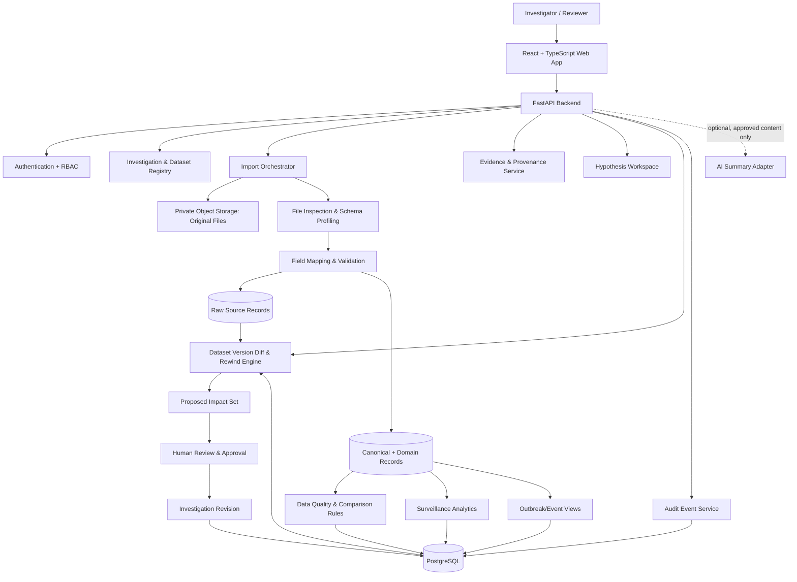

# OUTBREAK REWIND — Website & System Architecture
## Multi-Dataset Outbreak Investigation & Evidence Reconstruction Workspace

**Document type:** Revised architecture baseline  
**Prepared:** 12 November 2026  
**Status:** Proposed MVP architecture based on the nine datasets supplied  
**Operating mode:** Synthetic / public or otherwise approved research data only

---

## 1. Product definition

OUTBREAK REWIND is a multi-dataset workspace for exploring outbreak and disease-surveillance evidence, preserving source provenance, examining changes over time, identifying data-quality issues and contradictions, and reconstructing how an investigation's working interpretation changes when evidence is added or corrected.

Its central concept is **Evidence Rewind**:

1. Ingest and register a source dataset.
2. Preserve the original file and source-row identity.
3. Map source columns into a shared set of canonical fields while retaining dataset-specific fields.
4. validate records and make data-quality limitations visible.
5. Build appropriate analytical views from the information actually available.
6. When a source record is corrected or replaced, calculate which derived views and linked working hypotheses may be affected.
7. Present a before/after change set for human review.
8. Apply approved changes as a new revision while preserving the prior state and audit trail.

**Important boundary:** OUTBREAK REWIND is an evidence investigation and reconstruction workspace. It is not a diagnostic system, clinical decision-support tool, automated outbreak prediction engine, or operational public-health surveillance service.

## 2. Dataset inventory and implications

The initial dataset collection contains nine files:

| Dataset | Approximate rows | Available information | Natural analytical grain |
|---|---:|---|---|
| Ebola outbreaks (`ebola-outbreaks-ebolavirus-nl.csv`) | 28 | Country, location, strain, start/end year, cases, deaths, status, source fields | Outbreak |
| Reported cholera deaths (`number-of-reported-cholera-deaths.zip`) | 3,176 | Entity, country code, year, reported deaths | Country-year |
| Global dengue (`global_dengue_data.csv`) | 2,040 | Region, country, source, status, year/month, observed cases and seasonal estimates | Country-source-month |
| WHO influenza / respiratory surveillance (`VIW_FNT.csv`) | 189,871 | Country, WHO region, ISO week, specimens, influenza subtypes, other respiratory-virus detections | Country-week-laboratory surveillance |
| WHO COVID daily (`WHO-COVID-19-global-daily-data.csv`) | 583,440 | Date, country, WHO region, new/cumulative cases and deaths | Country-day |
| WHO COVID aggregated (`WHO-COVID-19-global-data.csv`) | 84,480 | Date, country, WHO region, new/cumulative cases and deaths | Country-reporting-period |
| WHO COVID deaths by age (`WHO-COVID-19-global-monthly-death-by-age-data.csv`) | 84,688 | Country, year/month, age group, deaths, income group | Country-month-age-group |
| WHO COVID summary table (`WHO-COVID-19-global-table-data.csv`) | 241 | Country/region, cumulative and recently reported cases/deaths, rates | Country-snapshot |
| NORS (`NORS.csv`) | 66,713 | Year/month, US state, primary mode, etiology, setting, illnesses, hospitalizations, deaths and food/water/animal fields | Reported outbreak |

Row counts are file-level counts before deduplication, validation, filtering, or reconciliation.

### 2.1 What these datasets can support

- **Outbreak-level exploration:** Ebola outbreak records and NORS outbreak records.
- **Longitudinal disease trends:** cholera annual deaths, dengue monthly cases, COVID daily/periodic data.
- **Laboratory surveillance:** influenza and other respiratory-virus detections.
- **Demographic analysis:** COVID deaths by age group.
- **Country-level snapshots:** COVID summary table.
- **Cross-source comparison:** only where disease, geography, time period, metric definition and reporting grain are compatible.

### 2.2 What these datasets do not support by themselves

Most supplied files are aggregated surveillance or outbreak-level datasets. They do not provide person-level case histories, named contacts, individual exposure chains, or a reliable person-to-person transmission network.

Therefore:

- Do not manufacture individual `Case` or `Contact` records from country-level totals.
- Do not infer transmission links from temporal or geographical proximity alone.
- Do not promise case-contact tracing for these datasets.
- Use aggregate time-series, outbreak/event and evidence-source views where that is the actual grain.
- Enable person/case/contact workflows only for a future dataset that legitimately contains those records and has passed privacy and governance review.

### 2.3 Source-specific cautions

- The two COVID time-series files have different reporting intervals/granularity. Keep them as separate source datasets; do not append them as if each row represented the same period.
- The COVID age-specific file is a separate demographic dimension, not a replacement for the overall time series.
- The COVID summary table is a snapshot-style dataset and should not be treated as a continuous historical timeline unless dated snapshots are supplied.
- Dengue includes observed and unobserved/estimated records and multiple source labels. Preserve `source` and `Data_status`; never display estimates as observed counts.
- VIW_FNT is a large weekly laboratory-surveillance dataset with many sparse fields. Preserve missing values and distinguish specimens processed, positive detections and other-virus fields.
- NORS contains outbreak-level records and multiple etiology/mode/setting fields. Missing etiology must remain unknown, not be assigned a guessed disease.
- The Ebola file has only 28 records and some incomplete source metadata. Validate source URLs, dates, unusual values and status before using a record as verified evidence.
- The cholera ZIP contains a CSV plus metadata/readme. Preserve the original ZIP and record the extracted CSV and metadata as components of the same import.

These are data-model and display cautions, not external verification of the datasets' scientific accuracy.

---

## 3. Product architecture: two investigation modes

The workspace should support two modes under one investigation shell.

### Mode A — Aggregate surveillance investigation

For country-, region-, year-, month- or week-level datasets.

Features:
- disease and geography filters;
- time-series and comparison charts;
- source and reporting-grain comparison;
- observed versus estimated status;
- missingness and data-quality indicators;
- evidence/source panel;
- version comparison and Evidence Rewind for changed aggregate records.

### Mode B — Outbreak/event investigation

For outbreak-level datasets such as Ebola and NORS.

Features:
- outbreak/event register;
- event detail and source provenance;
- geography and date context;
- etiology/strain/mode/setting fields where supplied;
- outcome summaries where supplied;
- evidence links and review flags;
- working hypotheses linked to source records;
- revision history and Evidence Rewind.

A single investigation may use more than one dataset, but the UI must show which datasets contribute to each metric, chart, event or interpretation. Comparisons across diseases or incompatible measurement definitions must be explicit and must not imply direct comparability.

---

## 4. Website information architecture

| Area | Route | Purpose |
|---|---|---|
| Landing | `/` | Product explanation and demo entry |
| Login | `/login` | Authentication |
| Workspace | `/workspace` | Investigation list and recent activity |
| Investigation overview | `/investigations/:id` | Scope, selected datasets, summary and status |
| Dataset library | `/investigations/:id/datasets` | Dataset registry and imported dataset versions |
| Dataset import | `/investigations/:id/datasets/import` | Upload CSV/ZIP and inspect file contents |
| Dataset detail | `/investigations/:id/datasets/:datasetId` | Schema, grain, provenance, quality and preview |
| Field mapping | `/investigations/:id/datasets/:datasetId/mapping` | Map source columns to canonical fields |
| Data quality | `/investigations/:id/data-quality` | Missingness, invalid values, duplicates and warnings |
| Surveillance explorer | `/investigations/:id/surveillance` | Aggregate trends, filters and comparisons |
| Outbreak register | `/investigations/:id/outbreaks` | Outbreak/event-level records |
| Timeline | `/investigations/:id/timeline` | Time-ordered events at supported granularity |
| Evidence | `/investigations/:id/evidence` | Source records, verification and provenance |
| Contradictions | `/investigations/:id/review-flags` | Conflicts, anomalies and missing-data review |
| Hypotheses | `/investigations/:id/hypotheses` | Human-authored working hypotheses and evidence links |
| Rewind | `/investigations/:id/rewind` | Impact preview and approval |
| History | `/investigations/:id/history` | Dataset, investigation and audit revisions |
| Reports | `/investigations/:id/reports` | Export selected analysis and audit information |
| Settings | `/settings` | Members, roles, retention and configuration |

The original `cases`, `contacts` and `network` routes should not be presented as core MVP pages for the supplied data. They can be added later if suitable record-level data becomes available. A generic relationship view may be added only for explicit, evidence-backed relationships between supported entities.

---

## 5. Primary user journey

1. Create an investigation and define its scope.
2. Upload one or more datasets.
3. Register each file, its source, licence/permission notes, version and import timestamp.
4. Inspect file structure, columns, sample rows and likely data grain.
5. Map source columns to canonical fields and retain unmapped source fields.
6. Validate data types, dates, codes, ranges, missingness and duplicate candidates.
7. Review warnings and approve the import for analysis.
8. Explore aggregate trends or outbreak/event records, depending on the dataset grain.
9. Attach source records to evidence items and create working hypotheses where appropriate.
10. Add a corrected or newer dataset version.
11. Calculate which normalized records, charts, summaries and linked hypotheses may be affected.
12. Review the proposed Evidence Rewind change set.
13. Approve, reject or request more information.
14. Save a new revision and preserve the previous state and audit events.
15. Export a report with dataset versions, filters, caveats and source references.

---

## 6. Dataset ingestion and normalization

### 6.1 Supported MVP formats

- CSV
- ZIP containing CSV and optional metadata/readme files

Excel and JSON can be added later through separate import adapters. Do not claim support until implemented and tested.

### 6.2 Dataset registry

Every imported dataset must have:

- dataset ID and investigation ID;
- display name and original filename;
- source organization/name, if known;
- source URL/reference, if supplied;
- licence/permission note and approval status;
- disease/topic tags;
- geographic coverage;
- temporal coverage;
- declared and detected data grain;
- file format and encoding;
- checksum;
- file size;
- schema version;
- dataset version;
- import status;
- imported by and imported at;
- validation summary and warnings.

### 6.3 Import pipeline

`Upload → File inspection → Safe extraction (ZIP) → Schema profiling → Field mapping → Validation → Duplicate assessment → Normalization → Import approval → Dataset activation`

Requirements:

- Preserve the original uploaded file unchanged in private object storage.
- For ZIP files, list archive contents and safely extract only permitted files.
- Enforce file size, row count, decompression and processing limits.
- Reject path traversal, unsafe archive entries and unsupported file types.
- Preview rows before committing an import.
- Retain source row number and stable source identifier where one exists.
- Do not assume that a row number is a durable identifier across changed file versions.
- Treat duplicate detection as a reviewable result; do not automatically delete similar records.
- Record every mapping and validation decision.

### 6.4 Canonical schema strategy

Do **not** force all source columns into one universal flat table.

Use a layered model:

1. **Raw layer:** original file and original row payload, unchanged.
2. **Canonical layer:** common fields that can be mapped reliably.
3. **Domain extension layer:** disease- or dataset-specific attributes.
4. **Analytical layer:** derived metrics and views with explicit source/version lineage.

Suggested shared fields:

- `record_id`
- `investigation_id`
- `dataset_id`
- `dataset_version_id`
- `source_record_id`
- `source_row_number`
- `disease_or_topic`
- `entity_type`
- `geography_name`
- `geography_code`
- `time_start`
- `time_end`
- `time_granularity`
- `metric_name`
- `metric_value`
- `metric_unit`
- `observation_status` (observed / estimated / unknown / not applicable)
- `verification_status`
- `raw_payload`
- `created_at`

These fields are optional when the source does not provide the information. Preserve the source's original names and values.

Domain extensions should cover, where available:
- outbreak: strain/etiology, outbreak status, cases, deaths, suspected counts;
- surveillance: specimens processed, positive detections, virus subtype;
- mortality: age group and reported deaths;
- food/waterborne outbreak: primary mode, setting, food vehicle, water exposure, illnesses, hospitalizations and deaths.

### 6.5 Time and metric semantics

Store separately:
- source event/reporting period;
- source publication or update date, if supplied;
- platform ingestion time;
- verification time/status.

Also preserve:
- daily, weekly, monthly or annual grain;
- count versus rate;
- cumulative versus new count;
- observed versus estimated value;
- source-defined age group and classification.

Never sum cumulative values across dates. Never compare rates with counts without an explicit transformation and denominator. Never convert missing values to zero unless the source documentation explicitly defines that meaning.

---

## 7. Main application modules

### 7.1 Investigation overview

Show:
- investigation title, purpose and scope;
- selected diseases/topics and geographic coverage;
- imported datasets and active versions;
- temporal coverage and data grain;
- total source records;
- validation warnings and unresolved review flags;
- latest rewind event;
- recent activity and last updated time.

### 7.2 Dataset library and detail

Show:
- file name, source and version;
- row/column counts and data grain;
- schema and field mappings;
- date and geographic coverage;
- preview of raw and normalized records;
- missingness and validation report;
- import history and checksum;
- warnings and approval state.

### 7.3 Surveillance explorer

Provide:
- filters for disease, country/region, date range, source and status;
- line charts for time series where time grain supports them;
- bar charts for country/region comparisons;
- demographic breakdowns where available;
- explicit metric labels, units and source citations;
- observed/estimated distinctions;
- missing-data and reporting-gap indicators.

Charts must not combine incompatible measures or grains by default. A user must be able to inspect the source datasets behind a displayed value.

### 7.4 Outbreak register

For outbreak-level sources, display only fields actually present:
- location and geographic precision;
- start/end dates or years;
- disease, strain or etiology;
- reported cases/deaths and suspected values;
- outbreak status;
- source and verification metadata.

Do not infer person-level case counts, contact chains or transmission routes beyond the source.

### 7.5 Timeline

- Display events at the temporal precision supplied by the source.
- Distinguish event/reporting period from ingestion time.
- Support day/week/month/year views as appropriate.
- Mark approximate, incomplete or unknown dates.
- Selecting an event opens its source record and provenance.
- A correction creates a new version; it does not erase the old value.

### 7.6 Evidence and provenance

Each evidence item should link to:
- dataset and dataset version;
- source row/record;
- original file and source reference;
- mapped fields used;
- verification status;
- notes and reviewer;
- derived views or hypotheses that depend on it.

### 7.7 Data-quality and contradiction workbench

Flag:
- missing required or expected fields;
- invalid date formats and impossible date order;
- negative counts where not permitted by the metric definition;
- duplicate source IDs or likely duplicate records;
- inconsistent country codes or geography labels;
- source-version changes;
- observed/estimated status conflicts;
- incompatible units or time grains;
- suspicious outliers for human review;
- conflicting values across sources for the same comparable geography, period and metric.

A cross-source conflict is valid only when the records are genuinely comparable. The system must show the comparison rule and source records; it must not automatically decide which source is correct.

### 7.8 Hypothesis workspace

A hypothesis contains:
- statement and rationale;
- supporting evidence links;
- contradicting/contextual evidence links;
- assumptions and limitations;
- expected observations;
- status: Working, Needs review, Weakened, Not supported by current evidence, or Inconclusive;
- author and revision history.

Hypotheses are investigator-authored interpretations, not model-generated epidemiological conclusions.

### 7.9 Evidence Rewind

When a new dataset version or corrected source record is imported:

1. Compare file checksum and dataset version.
2. Identify new, changed, removed and unchanged source records.
3. Match records using stable source identifiers where available; otherwise mark matching as uncertain and require review.
4. Identify normalized entities and metrics derived from changed records.
5. Identify charts, aggregates, flags and evidence links affected by those records.
6. Identify hypotheses linked to affected evidence.
7. Generate before/after values with source references and reason for change.
8. Present the proposed impact set to a reviewer.
9. Record approve / reject / needs-more-information decisions.
10. Apply only approved changes as a new investigation revision.
11. Preserve old dataset versions, derived snapshots and audit events.

For aggregate datasets, Evidence Rewind updates affected aggregate views and evidence interpretations. It does not create fictitious case-level events.

The first version should use deterministic version comparison and dependency links, not an LLM deciding which epidemiological conclusions are true.

---

## 8. Revised system architecture



### Component responsibilities

- **Frontend:** dataset management, mapping, quality review, surveillance charts, outbreak register, evidence, hypotheses and rewind approval.
- **FastAPI:** authentication, authorization, validation, business logic and versioned APIs.
- **Dataset registry:** dataset metadata, source details, versions, schema and import state.
- **Import orchestrator:** safe upload, ZIP inspection, parsing and job status.
- **Raw storage:** immutable original files and source payloads.
- **Normalization service:** canonical fields plus dataset-specific extensions.
- **Data-quality service:** deterministic validation, missingness, duplicate candidates and comparable cross-source checks.
- **Surveillance analytics:** aggregate metrics and charts that respect source grain and metric semantics.
- **Outbreak/event service:** outbreak-level records and supported event views.
- **Evidence service:** source lineage and verification metadata.
- **Hypothesis service:** human-authored interpretations and evidence links.
- **Rewind engine:** dataset-version comparison, dependency tracking and proposed impact set.
- **Audit service:** append-only history of important actions and decisions.
- **Optional AI adapter:** source-grounded summaries only; no automatic validation, diagnosis, prediction or approval.

---

## 9. Technology stack

| Layer | MVP choice | Notes |
|---|---|---|
| Frontend | React + TypeScript + Vite | Web application |
| UI | Tailwind CSS | Use one styling system |
| Charts | Recharts or ECharts | Choose one based on chart needs |
| API | Python + FastAPI | Typed REST API |
| Database | PostgreSQL | Metadata, normalized data, revisions and audit |
| ORM/migrations | SQLAlchemy + Alembic | Schema management |
| Validation | Pydantic | API schemas |
| Data processing | pandas | CSV profiling and normalization |
| Larger-file processing | pandas initially; evaluate Polars later | Avoid premature complexity |
| Graph UI | Cytoscape.js, only if a real relationship use case exists | Not required for initial supplied datasets |
| Background jobs | Add a task queue only when needed | Large VIW_FNT and COVID imports may need asynchronous processing |
| Object storage | S3-compatible private storage; local adapter for development | Original imports and exports |
| Authentication | Secure session/JWT approach with RBAC | Select provider during implementation |
| Testing | pytest + frontend tests | Import, mapping, rules and rewind |
| Packaging | Docker Compose | Repeatable local setup |

PostgreSQL is sufficient for the MVP. A graph database, microservices architecture, Kubernetes and Redis are not initial requirements.

---

## 10. Core database model

```text
User
- id, email, identity_provider_id, created_at

Investigation
- id, title, purpose, scope, status, created_by, created_at

InvestigationMember
- investigation_id, user_id, role

Dataset
- id, investigation_id, name, source_name, source_reference,
  disease_topic, geographic_coverage, temporal_coverage,
  declared_grain, detected_grain, status, created_at

DatasetVersion
- id, dataset_id, version_number, filename, checksum, file_size,
  object_key, schema_json, row_count, imported_by, imported_at,
  validation_status

DatasetFieldMapping
- id, dataset_version_id, source_column, canonical_field,
  domain_field, transformation_config, mapping_status

ImportJob
- id, dataset_version_id, status, started_at, completed_at,
  error_summary, validation_summary

SourceRecord
- id, dataset_version_id, source_record_key, source_row_number,
  raw_payload_json, source_record_time, created_at

NormalizedRecord
- id, investigation_id, dataset_version_id, source_record_id,
  entity_type, canonical_payload_json, domain_payload_json,
  verification_status, created_at

MetricObservation
- id, normalized_record_id, metric_name, metric_value,
  metric_unit, observation_status, time_start, time_end,
  time_granularity, geography_code, geography_name

EvidenceRecord
- id, investigation_id, source_record_id, normalized_record_id,
  evidence_type, verification_status, notes, created_by

OutbreakEvent
- id, investigation_id, normalized_record_id, disease,
  location, start_time, end_time, status

Hypothesis
- id, investigation_id, statement, rationale, status,
  created_by, created_at

HypothesisEvidenceLink
- hypothesis_id, evidence_record_id,
  relation_type [supports / contradicts / contextualizes]

QualityFlag
- id, investigation_id, dataset_version_id, source_record_id,
  rule_id, severity, details_json, status, reviewed_by

RewindEvent
- id, investigation_id, dataset_id, old_version_id,
  new_version_id, created_at, created_by, status

RewindImpact
- id, rewind_event_id, impacted_entity_type, impacted_entity_id,
  before_json, proposed_after_json, reason, source_references_json

ReviewDecision
- id, rewind_impact_id, decision, reviewer_id, comment, decided_at

InvestigationRevision
- id, investigation_id, revision_number, summary,
  created_by, created_at

AuditEvent
- id, investigation_id, actor_id, event_type, entity_type,
  entity_id, payload_json, created_at
```

Use foreign keys and indexes for investigation, dataset version, source record, geography and time fields. Use JSONB for source-specific payloads, not as a substitute for indexing frequently queried canonical fields.

For a small MVP, a single normalized-record table with typed domain payloads is acceptable. Split into disease-specific tables only when query patterns and validation requirements justify it.

---

## 11. Initial API design

| Method | Endpoint | Purpose |
|---|---|---|
| POST | `/api/v1/investigations` | Create investigation |
| GET | `/api/v1/investigations` | List investigations |
| GET | `/api/v1/investigations/{id}` | Investigation overview |
| POST | `/api/v1/investigations/{id}/datasets` | Register/upload dataset |
| GET | `/api/v1/investigations/{id}/datasets` | List datasets |
| GET | `/api/v1/datasets/{id}` | Dataset detail |
| GET | `/api/v1/datasets/{id}/versions` | Dataset version history |
| POST | `/api/v1/dataset-versions/{id}/profile` | Inspect schema and data grain |
| POST | `/api/v1/dataset-versions/{id}/mapping` | Save field mappings |
| POST | `/api/v1/dataset-versions/{id}/validate` | Run validation |
| GET | `/api/v1/dataset-versions/{id}/preview` | Preview imported rows |
| POST | `/api/v1/dataset-versions/{id}/activate` | Approve version for analysis |
| GET | `/api/v1/investigations/{id}/surveillance` | Query aggregate metrics |
| GET | `/api/v1/investigations/{id}/outbreaks` | List outbreak/event records |
| GET | `/api/v1/investigations/{id}/evidence` | List evidence |
| POST | `/api/v1/investigations/{id}/hypotheses` | Create hypothesis |
| GET | `/api/v1/investigations/{id}/quality-flags` | List quality flags |
| POST | `/api/v1/investigations/{id}/rewind` | Generate version impact preview |
| GET | `/api/v1/rewind/{id}` | View proposed changes |
| POST | `/api/v1/rewind/{id}/decisions` | Approve/reject/request information |
| GET | `/api/v1/investigations/{id}/history` | Revision and audit history |
| POST | `/api/v1/investigations/{id}/reports` | Generate report |

Every route must check investigation membership and role. Use pagination, request IDs, structured errors, upload limits and audit logging for sensitive actions.

---

## 12. Security, privacy and governance

- Use public, synthetic or explicitly approved research datasets only.
- Verify dataset licence, terms of use, attribution and redistribution permissions before deployment or sharing.
- Do not upload identifiable patient information into the MVP.
- Use role-based access and least privilege.
- Encrypt network traffic and protect secrets.
- Validate file types and safely process ZIP archives.
- Keep original imports, exports and audit records access-controlled.
- Record dataset source, version and processing history.
- Define retention and deletion policies.
- Do not send health data to an external LLM.
- AI summaries, if enabled, must use approved content and cite source records.
- Label estimates, missing values and unverified records clearly.
- Clearly label the product as a research/training demonstrator, not an operational public-health system.
- Obtain domain-expert, institutional, legal and security review before real-world deployment.

---

## 13. Deployment topology

### Local development

- React frontend.
- FastAPI backend.
- PostgreSQL.
- Local private object-storage adapter.
- Background worker only if large imports require it.
- Docker Compose for reproducible setup.

### Demo deployment

- One frontend application.
- One API service.
- Managed PostgreSQL.
- Private object storage.
- Optional worker for asynchronous import/report jobs.
- Isolated demo environment with no connection to real patient systems.

---

## 14. Implementation phases

### Phase 1 — Foundation
- Create application shell and authentication.
- Create investigations and member roles.
- Implement dataset registry and database migrations.

### Phase 2 — Multi-dataset ingestion
- Upload CSV and ZIP.
- Add file inspection and schema profiling.
- Build field mapping and preview.
- Preserve raw files and source records.
- Implement validation and import approval.

### Phase 3 — First usable analytical workflows
- Implement aggregate surveillance explorer.
- Implement outbreak/event register.
- Add source-level evidence and provenance.
- Add dataset filters and clear metric definitions.

### Phase 4 — Data quality and comparison
- Missingness and duplicate-candidate checks.
- Date, type, code and range validation.
- Comparable cross-source conflict rules.
- Review flags and reviewer decisions.

### Phase 5 — Evidence Rewind
- Dataset versioning and diff.
- Stable source-record matching.
- Dependency tracking for derived metrics and evidence.
- Before/after impact preview.
- Human approval and revision history.

### Phase 6 — Hypotheses and reporting
- Evidence-linked hypothesis workspace.
- Reports with filters, caveats, dataset versions and source references.
- Export and audit history.

### Phase 7 — Hardening and demo
- Import performance tests using the larger files.
- Permissions and security tests.
- Data-quality and rewind tests.
- End-to-end demo rehearsal.

---

## 15. MVP acceptance criteria

The MVP is accepted when:

1. A user can create an investigation and import more than one dataset.
2. CSV and ZIP imports preserve original files and source-row references.
3. Each dataset has its own schema, version, source metadata and data grain.
4. Users can map source fields without losing unmapped columns.
5. Missing, estimated, unknown and zero values remain distinguishable.
6. Validation warnings can be reviewed and recorded.
7. The surveillance explorer displays only metrics supported by the selected sources.
8. Outbreak/event views do not invent person-level cases or transmission links.
9. Every displayed metric or evidence item can be traced to source records and dataset versions.
10. Cross-source comparisons expose their matching rules and limitations.
11. A new dataset version produces a reviewable impact preview.
12. Only approved changes update the active investigation revision.
13. Prior versions and audit history remain inspectable.
14. The application can demonstrate at least one aggregate-surveillance workflow and one outbreak/event workflow end-to-end.

---

## 16. Decisions to keep explicit

| Decision | MVP position |
|---|---|
| Multiple diseases | Supported as separate disease/topic investigations |
| Multiple datasets per investigation | Supported |
| Universal flat schema | Rejected; use canonical fields plus domain extensions |
| Person-level case/contact tracing | Out of scope until suitable approved data exists |
| Cross-disease comparisons | Allowed only with explicit compatible metrics and caveats |
| COVID source files | Keep separate; relate by geography/time/metric where comparable |
| AI prediction | Out of scope |
| AI summaries | Optional, source-grounded and human-reviewed |
| Automatic contradiction resolution | Not allowed |
| Automatic rewind approval | Not allowed |
| Graph database | Not needed for MVP |
| Microservices | Not needed for MVP |
| Excel/JSON ingestion | Future extension; CSV/ZIP first |

## 17. Demonstration strategy

Build two complete, honest demonstrations from the supplied data:

**Demo A — Aggregate surveillance**
- Import a COVID time-series dataset.
- Show country-level trends over time.
- Compare the daily and aggregated sources only after aligning their reporting periods and metric definitions.
- Show age-specific mortality as a separate demographic view.
- Correct or replace a source version and demonstrate the Rewind impact preview.

**Demo B — Outbreak/event evidence**
- Import the Ebola outbreak dataset or NORS dataset.
- Inspect outbreak/event records and source provenance.
- Show missing or questionable fields as review flags.
- Create a working hypothesis linked to source records.
- Update a source record/version and show the affected evidence and proposed changes.

Do not present the two demos as proof of individual transmission reconstruction. The supplied data supports aggregate surveillance and outbreak/event evidence workflows, not person-level transmission-chain reconstruction.

---

**Architecture conclusion:** OUTBREAK REWIND should be built as a provenance-first, multi-dataset investigation workspace with two supported analytical modes: aggregate surveillance and outbreak/event investigation. Evidence Rewind is the differentiating workflow, while dataset versioning, source traceability, transparent data quality and human approval make that workflow defensible.

This is a proposed MVP architecture based on the uploaded file structures. Dataset accuracy, scientific interpretation, licensing and operational suitability require separate verification.
